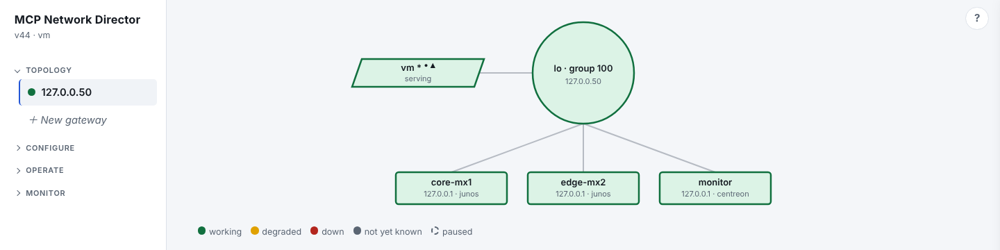
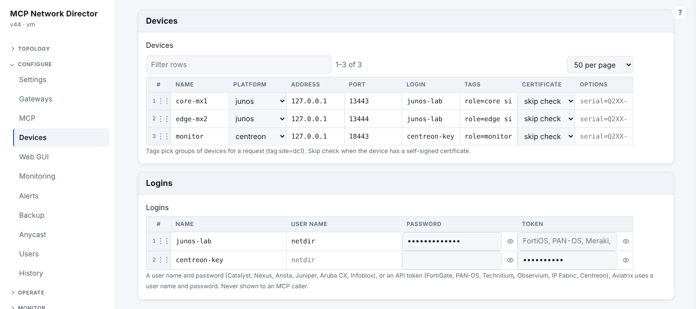
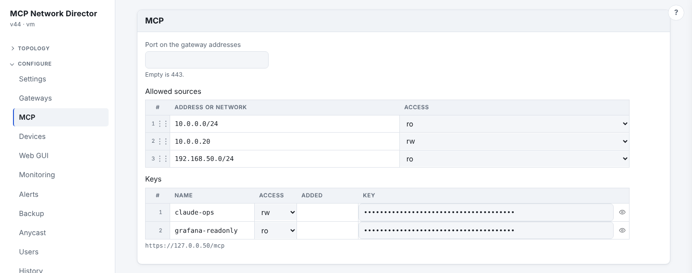
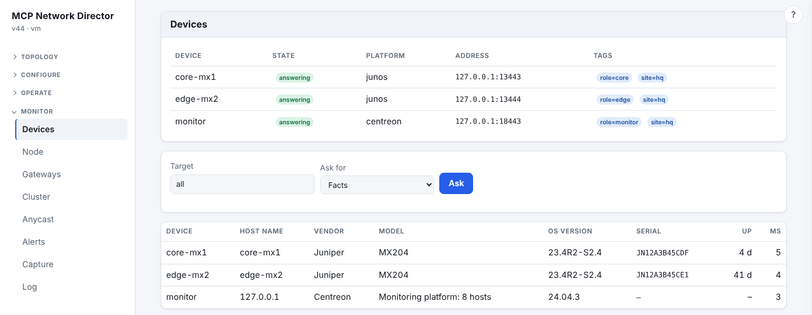
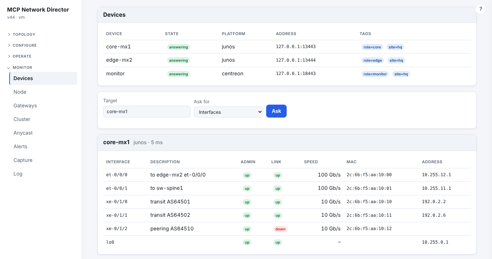
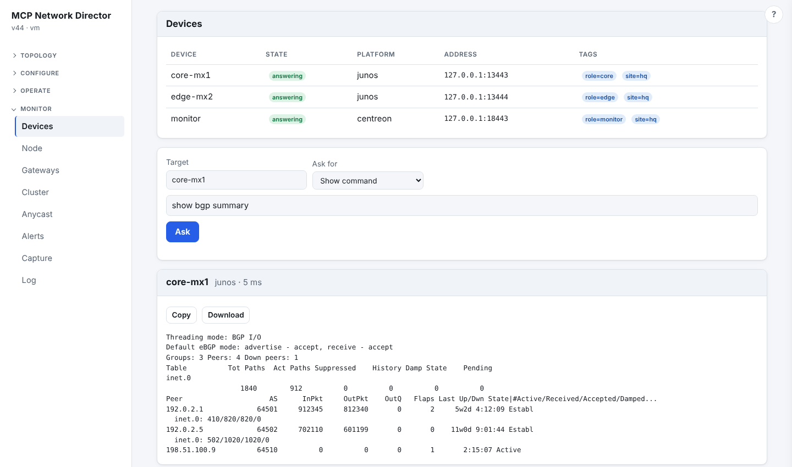

# MCP Network Director

MCP Network Director (`netdir`) is a highly available [MCP](https://modelcontextprotocol.io) gateway to a network's switches and firewalls. An assistant such as Claude connects to one address and can ask any device, or all of them at once, for its facts, interfaces, neighbors and configuration.

What you get:

- **One address that survives a node failure.** Several nodes share a virtual IP (the gateway's **VIP**). The nodes elect a controller among themselves and spread clients across every node. A node can fail or restart without the assistant losing the gateway.
- **Anycast over BGP or OSPF.** A gateway can also announce extra addresses to your routers through FRR, so every site reaches its nearest gateway. A node withdraws them when it cannot answer.
- **One inventory for every vendor.** Devices and their logins live in the cluster's shared settings, so any node can answer for any device. Each platform is a small driver that speaks the device's own API.
- **Read-only first, with guard rails.** Access is by address list or bearer key, and read-only is the default. Device passwords and tokens are never shown to an MCP caller. A device's configuration goes only to read-write callers, and `show` takes nothing that writes. Every call is logged.
- **A cluster you manage from any node.** Shared settings, config history, certificates and software updates stay in step across the nodes, through a web GUI or the command line.

## Screenshots

The web GUI, taken in a lab: two Juniper routers and a Centreon server behind one gateway (the devices are test stubs, not real gear).

**Topology**: the gateway, the node serving it, and the devices it answers for.



**Configure ▸ Devices**: the inventory and the logins the devices use (passwords and tokens are masked, and never shown to an MCP caller).



**Configure ▸ MCP**: who may use the endpoint, by address or by key, read-only or read-write.



**Monitor ▸ Devices**: ask every device, or a group of them, the same question. Facts from all three at once:



The interfaces of one router:



A show command on one device:



## Contents

- [Screenshots](#screenshots)
- [Status](#status)
- [How it works](#how-it-works)
- [Install, upgrade, uninstall](#install-upgrade-uninstall)
- [Managed devices](#managed-devices)
- [Connecting an assistant](#connecting-an-assistant)
- [MCP tools](#mcp-tools)
- [Security](#security)
- [Privacy levels](#privacy-levels)
- [Trying a device first: devprobe](#trying-a-device-first-devprobe)
- [Clustering](#clustering)
- [Anycast addresses, BGP and OSPF](#anycast-addresses-bgp-and-ospf)
- [Neighbor discovery (LLDP)](#neighbor-discovery-lldp)
- [Configuration file](#configuration-file)
- [Build from source](#build-from-source)
- [License](#license)

## Status

| Area | State |
|---|---|
| VIP election, anycast, BGP, OSPF, LLDP, cluster, users, backups, scheduler, updates | built in |
| Device inventory, credentials, MCP device tools | built in |
| Drivers | `iosxe` (Cisco Catalyst over RESTCONF), `nxos` (Cisco Nexus over NX-API), `eos` (Arista over eAPI), `junos` (Juniper Junos over its REST API), `aoscx` (Aruba CX over REST), `fortios` (FortiGate over REST), `panos` and `panorama` (Palo Alto firewalls and Panorama over the XML API), `nios` (Infoblox over WAPI), `technitium` (Technitium DNS Server over its HTTP API), `bigip` (F5 BIG-IP over iControl REST), `meraki` (Cisco Meraki over the Dashboard API), `entra` (Microsoft Entra ID over Microsoft Graph, read only: the devices of a user; browser sign-in or an application), `afc` (Aruba Fabric Composer over its REST API), `proxmox` (Proxmox VE over its REST API), `observium` and `centreon` (monitoring systems over their REST APIs), `ipfabric` (IP Fabric over its REST API), `aviatrix` (Aviatrix Controller), `dnsdir` (the DNS Director product, over its MCP endpoint) |
| Writes to devices | typed port changes from plain English on Catalyst IOS-XE, Arista EOS, Aruba CX and Meraki switches (`device_change`), and any configuration change on every platform (`device_change_raw`: REST request, PAN-OS action, or CLI lines); an `rw` key, ACL entry or GUI account may, `ro` may not; not yet run on real gear |
| `show` commands, text running-configs | NX-OS, EOS and PAN-OS answer them over their APIs; IOS-XE, ArubaOS-CX and FortiOS need an SSH transport, not built yet; Infoblox and Technitium have none |
| NX-OS, EOS, ArubaOS-CX, PAN-OS, Infoblox and Technitium drivers | built against vendor documentation and a test stub, not yet run on real gear (see the changelog) |
| Web GUI | Configure ▸ Devices edits the inventory and logins, Monitor ▸ Devices asks the devices and holds the network tools. |

## How it works

A **gateway** is one shared address, its VIP (IPv4, IPv6 or both), served by several nodes. The nodes of a gateway find each other over multicast, or over a unicast list where multicast is blocked, and elect one **controller (AGC)**. The others are **forwarders (AFN)**. The controller answers ARP and IPv6 neighbor solicitations for the VIP with the MAC address of a node chosen by the gateway's load-balancing method, so clients are spread over all the nodes. The MAC is either a virtual one per node, which another node takes over when that node fails, or, in real-MAC mode (the default for a new gateway), the node's own.

Every node that is active or forwarding answers on the VIP (and the other gateway addresses) with a listener of its own that serves only the MCP endpoint, `/mcp`, on port 443 by default (`settings.mcp_port`). The GUI does not answer on those addresses: it listens on port 22161 of the node's own addresses. A node whose MCP listener is not serving withdraws its anycast addresses, so traffic goes to a node that can answer.

One answer to an assistant is at most 1 MB by default and is cut, with a note, beyond that; `settings.mcp_max_result_mb` (Configure ▸ MCP ▸ Largest answer) raises it to at most 8. An assistant reads the answer into its context, and 1 MB of text is roughly 250,000 tokens, so ask for less before raising it.

An MCP request for devices is answered by the node that receives it. That node opens the driver for each device the target picks, asks up to 16 devices at a time with a time limit per device, and returns one result per device.

## Install, upgrade, uninstall

Supported systems are Ubuntu, Debian, Fedora, RHEL, Rocky, Alma, Arch and Manjaro, and their derivatives. netdir is Linux-only (macvlan, AF_PACKET, inotify).

```
tar xzf netdir_v3.tgz && cd netdir
sudo ./install.sh [--add-user NAME] [--no-start] [-y] [--dry-run]
sudo netdir-uninstall [--purge]
```

The installer builds netdir from the source tree with Go 1.24 or newer (it fetches a toolchain when the distribution's is too old). It installs only the missing prerequisites: gcc and the PAM headers, iproute2, FRR, nmap, ping and mtr, snmpd and lldpd. Then it sets up the `netdir` group, the PAM service, the systemd unit and `/var/lib/netdir`. Running it again on a newer tree upgrades. A start that fails rolls back to the previous binary.

`QUICKSTART.md` walks through a first gateway and connecting an assistant.

## Managed devices

Devices and their logins go in the shared `settings` block:

```json
"settings": {
  "devices": [
    {"name": "cat9300", "platform": "iosxe", "address": "10.0.0.2", "credential": "cat",
     "insecure": true, "tags": ["site=home", "role=access"]},
    {"name": "fg100e", "platform": "fortios", "address": "10.0.0.1", "credential": "fgt",
     "insecure": true, "tags": ["site=home", "role=firewall"], "options": {"vdom": "root"}},
    {"name": "n9k", "platform": "nxos", "address": "10.0.0.3", "credential": "cat", "insecure": true},
    {"name": "leaf1", "platform": "eos", "address": "10.0.0.10", "credential": "cat", "insecure": true},
    {"name": "dns1", "platform": "technitium", "address": "10.0.0.11", "credential": "pan", "insecure": true},
    {"name": "cx6300", "platform": "aoscx", "address": "10.0.0.6", "credential": "cat", "insecure": true,
     "options": {"api_version": "v10.09"}},
    {"name": "ddi", "platform": "nios", "address": "10.0.0.7", "credential": "cat", "insecure": true},
    {"name": "pa440", "platform": "panos", "address": "10.0.0.4", "credential": "pan", "insecure": true,
     "options": {"vsys": "vsys1"}},
    {"name": "pano", "platform": "panorama", "address": "10.0.0.5", "credential": "pan", "insecure": true,
     "options": {"device_group": "branches"}}
  ],
  "device_credentials": [
    {"name": "cat", "username": "netdir", "password": "…"},
    {"name": "fgt", "token": "…"},
    {"name": "pan", "token": "…"}
  ]
}
```

| Field | Meaning |
|---|---|
| `name` | unique; letters, digits, `.`, `-`, `_` |
| `platform` | `iosxe`, `nxos`, `eos`, `aoscx`, `fortios`, `panos`, `panorama`, `nios`, `technitium`, `bigip`, `meraki`, `entra`, `afc`, `proxmox` or `dnsdir` |
| `address` | IP address or host name, no port or scheme |
| `port` | the API port; default 443 |
| `credential` | the name of an entry of `device_credentials` |
| `tags` | free-form labels to target groups of devices: `site=dc1`, `edge` |
| `insecure` | skip the certificate check (most devices ship a self-signed one) |
| `ca_pem` | the CA the device's certificate must be signed by, instead of `insecure` |
| `options` | per platform: `vdom` for FortiOS; `vsys` (default `vsys1`) and `device_group` for PAN-OS; `api_version` (default `v10.09`) for ArubaOS-CX; `wapi_version` (default `v2.12`) for Infoblox |
| `disabled` | kept in the inventory, never contacted unless named on purpose |

### Cisco Catalyst (IOS-XE, `iosxe`)

RESTCONF, with HTTP basic authentication as a privilege-15 user. On the switch:

```
ip http secure-server
ip http authentication local
restconf
username netdir privilege 15 secret <password>
```

- **Facts** come from the native and device-hardware models.
- **Interfaces** come from interfaces-oper.
- **Neighbors** are LLDP, plus CDP on ports LLDP has none for.
- **Config** is the native YANG model as JSON, not `show running-config` text.

### Fortinet FortiGate (FortiOS, `fortios`)

The REST API with an API token. Make one under System ▸ Administrators ▸ Create New ▸ REST API Admin; a read-only profile is enough.

- **Facts** come from system status.
- **Interfaces** come from the monitor API, with descriptions and admin state from cmdb.
- **Neighbors** are LLDP, which needs `set lldp-reception enable` on the interfaces.
- **Config** is the backup file.

### Cisco Nexus (NX-OS, `nxos`)

NX-API with HTTP basic authentication as a user with the network-operator role. On the switch: `feature nxapi` (HTTPS on 443 by default; `nxapi https port` changes it).

- Only `cli_show` and `cli_show_ascii` are ever sent, and every command goes through `CheckShow`: nothing that writes.
- **Facts** are `show version` and `show inventory`; **Interfaces** and **Ports** (counters, rates) come from `show interface`.
- **Neighbors** are LLDP and CDP detail, merged by port; a feature that is off is left out.
- **Routes** are `show ip route vrf all` (and IPv6); **Routing** lists OSPF, BGP, EIGRP, IS-IS, RIP, BFD, HSRP, VRRP and more as parts, with `unavailable` saying what a switch did not answer.
- **Firewall** is the ACLs with their match counters, object groups and CoPP; **Resources** are CPU, memory, fans, temperatures and power; **VLANs** are `show vlan brief`.
- **Config** is `show running-config`; **Show** runs one show command as text.
- **API** (`device_api_get`) is the NX-API REST object model (`/api/mo/…`, `/api/class/…`), read after a login whose session is closed again.

### Arista EOS (`eos`)

eAPI, the JSON-RPC interface at `/command-api`, with HTTP basic authentication as a user whose privilege level allows the commands (15 for the running configuration). On the switch: `management api http-commands`, `protocol https` and `no shutdown`.

- Only `runCmds` with the format `json` or `text` is ever sent, one command per request, and every command goes through `CheckShow`: nothing that writes, and no `enable` or `configure`.
- **Facts** are `show version` and `show hostname`; **Interfaces** and **Ports** (counters, rates) come from `show interfaces`; **Neighbors** are `show lldp neighbors detail`.
- **Routes** are `show ip route vrf all` (and IPv6); **Routing** is BGP, OSPF, IS-IS, BFD, VRRP, MLAG, route maps and prefix lists as parts, with `unavailable` saying what a switch did not answer.
- **Firewall** is the access lists (IP, IPv6, MAC) with their counters; **Resources** are memory, CPU (`show processes top once`), fans, temperatures and power supplies; **VLANs** carry their ports.
- **Config** is `show running-config` and **Show** runs one show command, both as the text the CLI prints.
- **API** (`device_api_get`) names a show command as a path and answers its JSON: `/eapi/show/ip/route/vrf/all` is `show ip route vrf all` (`%2F` for a `/` in a word, `?format=text` for text).

### Aruba CX (ArubaOS-CX, `aoscx`)

The REST API (10.04 and later) with a user name and password. The driver logs in once (the credentials in the form body, never in a URL; the login is the only POST), keeps the session and logs out when the request ends. On the switch: `https-server rest access-mode read-only` and `https-server vrf mgmt` (or the VRF it is reached on), and a user in a read-only group. The option `api_version` (default `v10.09`) names the REST version; a release that lacks it answers 404.

- **Facts** are `/system` (status and configuration) and the chassis subsystem; **Interfaces** and **Ports** (statistics, status and configuration as properties) come from `/system/interfaces`.
- **Neighbors** are LLDP, asked per front-panel port that is up.
- **Routes** are every VRF's routes (one entry per next hop); **Routing** is each VRF's BGP, OSPF, OSPFv3 and static routes, route maps and prefix lists.
- **Firewall** is the ACLs with their entries and hit counters, object groups, classes and policies.
- **Resources** are CPU and memory from the subsystems' resource utilization, and fans, temperatures and power supplies; **VLANs** carry the ports of each VLAN.
- **Config** is the running configuration as JSON (`fullconfigs/running-config`). `show` commands are not available: the REST API runs none.
- **API** (`device_api_get`) reads any `/rest/<version>/...` resource; the login and logout resources are refused.

### Infoblox NIOS (`nios`)

The WAPI (`/wapi/<version>/`) with HTTP basic authentication as an admin whose group may read. Only GET is sent; function calls (`_function`), which change things or make backups, are refused. The option `wapi_version` (default `v2.12`) names the WAPI version.

NIOS is a DNS, DHCP and IPAM appliance, not a switch or a firewall, so only what fits is answered:
- **Facts** are the grid member whose VIP or host name is the device's address (the only member if there is one), with its hardware model and serial number and the NIOS version from its upgrade status; for an address that is no member's, the grid's name.
- **Interfaces** are that member's LAN1, LAN2, MGMT and HA addresses (every member's, named `host/lan1`, when the address is no member's).
- **Resources** are the capacity report (objects held against what the hardware is rated for, as storage) and the state of each member's services (DNS, DHCP, ...).
- **API** reads any object type: networks, ranges, zones, records, leases, ... (`/wapi/v2.12/network?_max_results=50`); the catalog lists the types the release has.
- Neighbors, routes, routing, firewall, VLANs, port counters, configuration and `show` answer "unsupported".

### Technitium DNS Server (`technitium`)

The HTTP API (Technitium 15.0 and later) on its HTTPS port, 53443 by default (turn on HTTPS for the web service in Settings ▸ Web Service; the plain-HTTP port is never used). The credential is an API token (Administration ▸ Sessions ▸ Create API Token), sent as `Authorization: Bearer`, never in a URL; or a user name and password, from which the driver logs in and logs out again.

Technitium's API changes things with plain GET requests (a zone is deleted with one), so being a GET is no safeguard here: **only endpoints whose name is `get`, `list` or `query` (or begins with one: `getTop`, `listStoreApps`) are ever sent**, and a token or password parameter in a request is refused.

Technitium is a DNS server and not a switch, so (as with Infoblox) only what fits is answered:
- **Facts** are the server's name, version and uptime; **Interfaces** are the addresses it listens on; **Resources** are the dashboard's statistics for the last hour and day.
- **API** reads everything it lists: zones, records, the cache, blocked and allowed domains, DHCP scopes and leases, apps, the query log (`/api/zones/list`, `/api/dashboard/stats/get?type=LastHour`).
- Neighbors, routes, routing, firewall, VLANs, port counters, configuration (the backup is a file) and `show` answer "unsupported".

### F5 BIG-IP (`bigip`)

iControl REST (BIG-IP 13.1 and later) on port 443, with a user name and password (basic authentication) or an auth token as the credential's token. A user with the Guest or Auditor role reads; changes need an account that may make them. Facts come from `/mgmt/tm/cm/device`; Interfaces are the physical interfaces and the self IPs; Ports are the interface statistics (bits in and out become octets); Routes and Routing are the static routes, BGP, OSPF, BFD and route domains; VLANs carry their tag; Firewall is the AFM policies, rule lists, address and port lists and NAT policies; Resources are CPU, memory, disk and the failover state. The API request reads any `/mgmt/tm/...` path except util, authentication, UCS archives and file transfer. Neighbors, configuration text and `show` answer "unsupported".

### DNS Director (`dnsdir`)

The DNS Director product, managed through its own MCP endpoint (`POST /mcp` on its GUI port, 53853). The credential's token is an **MCP key** made on the director (Configure ▸ Monitoring ▸ MCP ▸ Keys); its `ro` or `rw` is the access, so a `ro` key reads and a `rw` key also changes. A password is not used. The option `node` names the cluster node the tools ask about (an address or host name from the director's node list); without it the node serving the endpoint answers.

- **Facts** are the node and the release (`v635`) from `list_nodes`, with the number of nodes in the cluster; **Interfaces** and **Resources** (CPU, load, memory, swap, file systems, network rate) are the node's host statistics; **Neighbors** are its LLDP neighbors.
- **Show** takes `show NAME [node=… range=… top=… gateway=… transport=…]`, where NAME is one of the director's read tools: `nodes`, `topology`, `gateways`, `alerts`, `log`, `query-stats`, `host-stats`, `server-stats`, `schedule`, `updates`, `node-status`, `lldp`, and `dns`. **API** reads any `/api/…` route of the director's GUI API (the catalog lists them); **Config** is its configuration.
- Each director hides its own secrets in every answer. No ports, routes, VLANs or firewall.
- **Changes** (`device_change_raw`, rw key): method `SET` merges the JSON body into the director's configuration (`{"dns": {"cache_entries": 200000}}`; a dry run asks the director to check it without saving), and `POST` or `PUT` with a path under `/api/` calls a route of its GUI API. The director keeps every configuration change in its own history, which is the way back; netdir does not put it back itself. Login, logout, the session and sign-in routes are refused.

### Microsoft Entra ID (`entra`)

Microsoft Graph (`https://graph.microsoft.com/v1.0`), **read only**, for one question: which devices belong to a user. Address `graph.microsoft.com` (left empty it is that); `login_host` names another sign-in host for a national cloud (`login.microsoftonline.us` with address `graph.microsoft.us`). Two ways to log in:

- **Browser sign-in** (nothing to register in Entra). Add the device with a **new login and leave user name, password and token empty**, then right-click the device ▸ **Sign in with Microsoft** (or `netdir --device-signin NAME`). The page shows a code and a link; you open it on any computer and sign in (multi-factor included). The device then sees what that account may see: delegated `User.Read.All` and `Device.Read.All` through Microsoft's public client "Microsoft Graph Command Line Tools", with no secret. By default any member of a tenant may read users and their devices; a tenant can restrict that or require consent for that client. The refresh token is kept in the login as `rt:…` (a login with only `rt:` is a login not yet signed in) and is renewed as it is used (saved at most once a day); sign in again when it is revoked or unused for 90 days. Option `tenant` (ID or domain) is optional here; without it the sign-in is to "organizations".
- **Application** (unattended, no person). Register an app in Entra, add the **application** permissions `Device.Read.All` and `User.Read.All` (Microsoft Graph), grant admin consent and create a client secret. The login's **user name** is the application (client) ID and its **password** the secret; option `tenant` is the directory ID or a verified domain. The token is asked for once per connection.

- **Facts**: the tenant's name and ID. No interfaces, neighbors or configuration.
- **Show** `show devices user=<sign-in name | object ID | name>`: the devices the user has **registered** and the devices the user **owns**, each once with a `relation` list, sorted by name (id, deviceId, name, operating system and version, trust type, compliance, managed, last sign-in). A name that matches several users is refused with the candidates listed. `show user user=…` shows the user. The API request reads only `/organization`, `/users`, a user's `registeredDevices` and `ownedDevices`, and `/devices`.
- **Changes** (`device_change_raw`, rw key): `POST`, `PUT`, `PATCH` or `DELETE` with a path at `/users`, `/devices`, `/groups` or `/organization` (below `/v1.0`) and a JSON body (`PATCH /devices/{id}` with `{"accountEnabled": false}`). The application needs the matching write permission (for example `Device.ReadWrite.All`). Refused: sign-in methods, passwords and keys, roles and consent, policies, and a user's mail and files. The copy of what the path held is returned as `before`; a Graph change is not put back automatically. Starting a sign-in changes a login, so it needs the access a device change needs (not a read-only account, and there is no MCP tool for it).

### Proxmox VE (`proxmox`)

Proxmox VE over its REST API (`https://<host>:8006/api2/json`; the port defaults to 8006, and a self-signed certificate needs *skip check*). The login is an **API token** (Datacenter ▸ Permissions ▸ API Tokens): the credential's token is `user@realm!id=secret`, or its user name is `user@realm!id` and its token the secret. A token whose user has only the `PVEAuditor` role reads and nothing more. Or a user name with its realm (`root@pam`) and a password, for which the driver takes a ticket and renews it (not for an account with two-factor login). Option `node` is the node that node-scoped reads ask when none is named (default: the node answering).

- **Facts**: the cluster's name, its node count and the Proxmox VE version. **Interfaces**: the node's network (bridges, bonds, NICs, with address and active state). No neighbors or configuration text.
- **Show** `show NAME [node=N] [vmid=ID]`: `version`, `cluster`, `resources`, `vms`, `storage`, `nodes`, `tasks`, `backups`, `not-backed-up`, `ha`, `ha-resources`, `firewall`, `firewall-options`, `options`, `log`, `pools`; per node `node-status`, `node-network`, `node-disks`, `node-services`, `node-tasks`, `node-storage`, `node-time`, `node-vms`, `node-cts`, `node-syslog`; per guest `vm-config`, `vm-status`, `vm-snapshots`, `vm-firewall`, `vm-agent`, `ct-config`, `ct-status`, `ct-snapshots`, `ct-firewall`, `ct-interfaces`. A guest's node is found from its `vmid`. The API request reads `/version`, `/cluster/…`, `/nodes/…`, `/pools` and `/storage`; accounts, tickets, consoles, ACME accounts, join information and the guest agent's commands and files are never read. Secrets by name (a guest's `cipassword` and the like) are hidden.
- **Changes** (`device_change_raw`, rw key): `POST`, `PUT` or `DELETE` with a path below `/nodes`, `/cluster`, `/pools` or `/storage` and a JSON body: start, stop, shut down or reset a guest (`POST /nodes/pve1/qemu/100/status/start`), change its configuration (`PUT …/config`), snapshots, backups (`POST /nodes/pve1/vzdump`), migration, storage, network, HA and firewall settings. A change that starts a task is waited for (up to ten minutes) and answers with how the task ended; a failed task is an error with the last lines of its log. A dry run reads what the path holds now and sends nothing. A `PUT` is not put back on failure (the configuration's digest changes), the copy in `before` shows what was there.
- **Never done here**: users, roles, permissions, tokens and realms; cluster create, join and removal; rebooting or shutting down a node, or stopping everything on it; stopping a node's services; consoles and shells; certificates; **deleting a VM or container, deleting a storage or its volumes; restoring a backup** (a body with `archive`) **or rolling back a snapshot**; removing or wiping disks; the guest agent's commands and files. They are refused before anything is sent.
- Not run against a real Proxmox.

### Aruba Fabric Composer (`afc`)

The on-site controller for Aruba CX VXLAN/EVPN fabrics, over its REST API (`https://<host>/api/v1`). The login is a user name and password; the driver asks for a token (`POST /api/v1/auth/token`), sends it as the `Authorization` header, renews it when refused and deletes it when it is done (a user may hold ten). Port 443; a self-signed certificate needs *skip check*.

- **Facts**: the fabrics the controller manages. **Show** `show <resource> [name=value …]` reads any resource collection (`show fabrics`, `show switches`, `show vrfs`, `show vlans`, `show vlan_groups`, `show switches name=leaf1`); the AFC's own API Explorer (the ? at the top right of its web page) lists the resources. The API request reads `/<resource>`, `/<resource>/<uuid>` and `/<resource>/<uuid>/<sub resource>`. Users, roles, authentication servers, tokens, keys, licences and backups are never read. Aruba's pages show the resources both below `/api/v1/` and below `/api/v1/api/`; a 404 at the first is tried at the second.
- **Changes** (`device_change_raw`, rw key): `POST`, `PUT`, `PATCH` or `DELETE` with a path below `/api/v1/` and a JSON body. A `PUT` keeps the old record and puts it back when the request fails in a way that may have changed something. Not changed: users, roles, authentication, certificates, keys, licences, backups and restores, upgrades, reboots and resets. Not run against a real controller.

NetEdit has no documented API, so it has no driver; the Aruba CX switches it manages can be added directly as `aoscx`.

### Cisco Meraki (`meraki`)

The Dashboard API (`https://api.meraki.com/api/v1`), with an **API key** as the credential's token (a dashboard administrator with read-only access makes a key that only reads). Address `api.meraki.com` (left empty it is that). A Meraki network is a cloud, so a device here is one of two things:

- **An organization** (no options; option `org` is its ID and may be left out when the key sees only one): **Facts** are the organization's name and its device count; **Interfaces** are the MX uplinks of every appliance (`Q2XX-… wan1`, status, address); **Show** takes `show NAME [network=ID] [serial=SERIAL]` with `networks`, `devices`, `statuses`, `uplinks`, `inventory`, `changes` (the dashboard's change log), `clients`, `ssids`, `vlans`, `firewall`, `device`, `switchports`, `portstatus` and `lldp`; **the API request** reads any `/organizations/…`, `/networks/…` or `/devices/…` path. Administrators, SAML, SNMP, VPN and license paths are refused over MCP, and keys, pre-shared keys and community strings are hidden.
- **One Meraki device** (option `serial=Q2XX-XXXX-XXXX`): its facts (name, model, firmware), a switch's **ports** (name, enabled, status, speed, uplink flag) and interfaces, its LLDP and CDP **neighbors**, and **typed port changes** in plain English with ports as Meraki numbers them (`change the description for ports 1-8 to read "desks"`, `shut down 12`). A switch's uplink port is never shut down, because it would cut the switch off from its dashboard.

**Changes** (`device_change_raw`, rw key): `POST`, `PUT` or `DELETE` with a path below `/organizations/`, `/networks/` or `/devices/` and a JSON body. Meraki has no commit: a change is live at once. A `PUT` keeps the copy of what the path held and puts it back when the request fails in a way that may have changed something (a 5xx, a lost connection); a `POST` or `DELETE` is not undone. Refused: administrators, SAML, login security, SNMP, licenses, the management interface, firmware, reboot, claim, remove, release, clone, combine, split, and deleting an organization, network or device. Options are set in the device dialog (Options) or as `"options": {"serial": "Q2XX-XXXX-XXXX"}` in `devices`. Rate limits (HTTP 429) are waited out twice; lists are asked with `perPage=1000` and further pages are not fetched; the redirect to a regional shard (`nNNN.meraki.com`) is followed with the key, to a `meraki.com`, `.cn`, `.ca` or `.in` host over https only.

### Palo Alto Networks (PAN-OS, `panos`, and Panorama, `panorama`)

The XML API at `/api/`, with an admin's API key as the credential's token, or a user name and password from which a key is made (the only POST sent, with the password in the body, never in a URL). The key travels in the `X-PAN-KEY` header and never reaches an error text. Give the admin an XML API role that allows Operational Requests and Configuration, read only.

- Platform `panos` recognises a Panorama from its system information; `panorama` forces it. Options: `vsys` (default `vsys1`) and, for a Panorama, `device_group`.
- **Facts** are `show system info`; **Interfaces** and **Ports** are `show interface all` and the interface counters, with comments and link state from the configuration; the management interface is included.
- **Neighbors** are LLDP; **Routes** and **Routing** (BGP, OSPF, RIP, BFD, multicast and the virtual routers' configuration) are a firewall's.
- **Firewall** is the rules' hit counters (security, NAT, PBF, decryption, application override), sessions and the policy and object configuration. On a Panorama it is the managed devices, device groups, templates, and shared and device-group rules and objects.
- **Resources** are CPU and memory (from `show system resources`), disks and the environmentals; **VLANs** are the VLAN interfaces.
- **Config** is the running configuration as XML. **Show** takes an operational command as typed on the CLI (`show system info`; a double-quoted word is a value) and is converted to XML; pipes are refused.
- **API** reads `type=op` (a `<show>` command) or `type=config` with `action=show` or `get`; other types, a `key` parameter and anything that writes are refused.
- A Panorama answers no routes, routing or VLANs (`unsupported`). PAN-OS's advanced routing engine's live state is not read.

### Observium (`observium`)

The REST API of Observium (`https://HOST/api/v0/`; switch it on with `$config['api']['enable'] = TRUE;` in `config.php`; the documentation lists the API as a feature of the Subscription Edition), over HTTPS, port 443. The credential is an **API token** (Profile ▸ API tokens; one made *read only* only reads), sent as a Bearer token, or a **user name and password** (HTTP basic authentication). Neither is ever put in a URL, and reading sends only `GET`. Observium is a monitor, so a device here is one of two things:

- **The Observium server** (no options): **Facts** say how many devices it monitors; **Resources** are the alerts that have failed and the state of every device; neighbors, ports and interfaces answer `unsupported` (ask for a device). **Show** takes
  - `show device NAME`: **everything Observium knows about one monitored device in one answer**: its record, ports, addresses, neighbours, sensors, status indicators, storage, memory pools, processors, inventory, counters, probes, alerts and its recent alert log, with a count of each and a note for a part Observium would not answer. NAME is the host name, a short name that fits exactly one device (`ipam2` finds `ipam2.example.com`), or the Observium device ID; a name that fits several is refused with the list.
  - `show NAME [device=NAME] [filter=value …]` for one list: `devices`, `ports`, `neighbours`, `sensors`, `status`, `storage`, `mempools`, `processors`, `inventory`, `counters`, `probes`, `alerts`, `alert_log`, `address`, `groups`, `maintenance`, `vlans`. With `device=NAME` the list is that device's; any other `filter=value` is passed to Observium (`show alerts status=failed`, `show devices os=ios`, `show ports device=ipam2 ifOperStatus=down`). A list that is not about one device is cut to 500 rows (the answer's `count` says how many there are; `pageno=2` asks for the next page).
- **One monitored device** (option `device`, its host name or Observium device ID): **Facts** (host name, vendor or OS, hardware, version, serial, uptime), **Interfaces** and **Ports** (state, speed, MAC, addresses, every counter and every other field of the port; deleted ports are left out), **Neighbors** (LLDP, CDP and the like, with every field Observium holds; inactive ones are left out), **Resources** (CPU from the processors, memory pools, storage, and sensors with kind, state, reading and units), and `show device` without a name.

The **API request** (`device_api_get`) reads `/devices/…`, `/ports/…` and the other entities above, and `/openapi.json`, Observium's own description of every answer. SNMP communities and SNMP authentication and privacy passwords in a device's record are hidden everywhere. Option `prefix` is the path Observium is served below (`/observium`). A `429` (Observium throttles) is waited out once.

The documentation of the API gives the shape of an answer for devices only. The driver finds the rows of any answer whatever its wrapper, reads each field under the names Observium's database uses, and **keeps the whole row** next to what it reads from it (`properties`, `detail`, `raw`, `details`), so a field it does not know is still there. **Changes** (`device_change_raw`, rw key): `POST`, `PUT`, `PATCH` or `DELETE` with a path below `/api/v0` and a JSON body (`PATCH /devices/12/`). Users, tokens and login are refused. Observium's documented API is read-only, so whether a request is accepted depends on the edition and build; a refused request changes nothing, and nothing is put back automatically.

### IP Fabric (`ipfabric`)

The REST API of IP Fabric (`https://HOST/api/<version>/`), over HTTPS, port 443. The credential is an **API token** (sent as `X-API-Token`) or a **user name and password** (`POST /auth/login`, then a Bearer token); neither is ever put in a URL. The URL form is found by the driver: IP Fabric 7.5 and later have no version in the path (`/api/snapshots`, the version is the `X-API-Version` header, whose default is used), and 8.1 refuses the old `/api/v8.1/snapshots` (404 `API_NOT_FOUND`); older releases need `/api/v7.3/…`. The driver reads the release from `GET /api/version`, tries the form that fits it first and uses the first that answers; the option `api_version` forces one (`none` for `/api/…`, `v7.3` for `/api/v7.3/…`); the option `snapshot` (default `$last`) picks the snapshot the tables are read from. IP Fabric models a whole network, so the device here is the IP Fabric server:

- **Facts**: the release and how many devices the snapshot holds. **Interfaces**: the interfaces table, named `hostname:interface` (up to 5000 rows). No neighbors, routes or configuration through the named tools.
- **Show** (`device_show`): `show devices|interfaces|sites|hosts|arp|snapshots [snapshot=ID] [columns=a,b] [limit=N] [start=N] [sort=col|-col] [column=value ...]` (`*` in a value is a substring match), `show tables/<section>/<table>` for any other table, **`show device NAME`**: the record, interfaces and ARP entries of one discovered device in one answer, and **`show diagnose`**: sends a fixed set of requests (version, `/os/version` with and without the credential, snapshots, two tables) and lists what IP Fabric answered to each, to tell a wrong path from a refused credential.
- **API request** (`device_api_get`): `/tables/<section>/<table>?columns=a,b&limit=100&snapshot=$last&column=value` (IP Fabric reads tables with POST; the driver sends that read), `/snapshots`, `/jobs`, `/version`, `/os/version`.
- **Changes** (`device_change_raw`, rw key): `POST`, `PUT`, `PATCH` or `DELETE` with a path below `/api/<version>` and a JSON body: lock, unlock, load, unload and delete snapshots, start a discovery, add or rediscover devices. Users, tokens, login, single sign-on, licences and the system are refused. A dry run returns the copy of what the path holds; nothing is put back automatically.

The column names are those IP Fabric documents for these tables. A column a release does not have is refused by the server (the driver then retries with a minimal set); pick columns with `columns=`. Secrets found by name in an answer are hidden. IP Fabric was written against its documentation only and has not been run against a live IP Fabric; the sign-in with a user name and password in particular.

### Aviatrix (`aviatrix`)

The Aviatrix Controller's API (`https://HOST/v2/api`; option `api_path` for another, such as `/v1/api`), over HTTPS, port 443. Every call is an *action* with parameters, sent as a form; the answer is `{"return": true|false, "results": …, "reason": "…"}`. The credential is the controller's **user name and password**: the driver asks for an API token (`get_api_token`), signs in with it (`login`, header `X-Access-Key`), keeps the session ID (CID) and sends it in the form of each call (never in a URL; reads are POSTs too). An expired session is renewed once. The device is the controller:

- **Facts**: the release and how many gateways it manages. **Interfaces**: the gateways, with state, addresses, size, cloud and region.
- **Show** (`device_show`): `show gateways|transit|spoke|peerings`, **`show gateway NAME`** (summary, details and transit peerings of one gateway in one answer) and `show ACTION [name=value …]` for any read action (`list_…`, `get_…`, `show_…`).
- **API request** (`device_api_get`): `/ACTION?name=value`, the same reads. Actions whose names speak of users, administrators, passwords, keys, certificates, tokens, SAML, LDAP, single sign-on, licences or backups are refused.
- **Changes** (`device_change_raw`, rw key): method `POST`, body `{"action": "edit_gw_config", "gateway_name": "gw1", …}` or `action=…&name=value`; the session ID is added. Login, users and administrators, credentials, backups and restores, and deleting a gateway are refused, as is any parameter named like a password, key or token. A dry run returns the gateway's details when a `gateway_name` is given; nothing is put back automatically. No reboot: no action for it is known.

The action names and result fields are those of Aviatrix's Terraform provider. This driver has been tested against a stub only, never a real controller.

### Centreon (`centreon`)

The REST API v2 of Centreon (`https://HOST/centreon/api/latest/`), over HTTPS, port 443. Option `prefix` says where Centreon is below the host (`/centreon` by default, `none` for the root), option `api_version` fixes a release (`24.04`) instead of `latest`. The credential is an **API token** (a personal access token, Centreon 23.10 and later; sent as `X-AUTH-TOKEN`) or a **user name and password** (`POST /login`, then the session token in `X-AUTH-TOKEN`; an expired session is renewed once). Neither is ever put in a URL.

The device is the Centreon central server:

- **Facts**: the platform version and how many hosts it monitors. **Interfaces**: the monitored hosts (up to 5000), with address, poller, and up or not.
- **Show** (`device_show`): `show platform|pollers|hostgroups|servicegroups|downtimes`, `show hosts [status=down|unreachable|up|pending] [search=TEXT] [limit=N]`, `show services [host=NAME] [status=ok|warning|critical|unknown|problem] [search=TEXT] [limit=N]`, `show problems` (hosts that are not up, services that are not ok) and **`show host NAME`** (name, alias, address or ID): the monitoring record, the configuration, the services with their status and the recent timeline of one host in one answer. A part the user may not read is named under `errors`; the rest is still answered.
- **API request** (`device_api_get`): any read below `/monitoring`, `/configuration` and `/platform`; lists take `limit`, `page`, `sort_by` and `search`. Users, contacts, access rights, tokens, authentication and administration are refused. The prefix and `/api/latest` may be left out or given.
- **Changes** (`device_change_raw`, rw key): `POST`, `PUT`, `PATCH` or `DELETE` below `/monitoring` (acknowledge, downtime, check, submit result) and `/configuration` (hosts, services, templates, groups, commands, pollers) with a JSON body. Centreon applies a configuration change to the pollers only when it is exported: send the request with *save* (it posts to `/configuration/monitoring-servers/generate-and-reload`, Centreon 23.10 and later) or export from the web interface. A dry run returns the copy of what the path holds; nothing is put back automatically. Commands defined in `/configuration/commands` run on the pollers: give that access only to keys that should have it.

Secrets found by name in an answer (SNMP communities, passwords, tokens) are hidden. The field names are those of Centreon's API documentation; `show host` keeps the whole record, so a field a release names otherwise is still shown. This driver has been tested against a stub only, never a real Centreon.

### Juniper Junos (`junos`)

Junos through its REST API: every RPC is `https://HOST:3443/rpc/<rpc-name>?<arguments>` (GET), or `POST /rpc` with the RPC as XML. On the device: `set system services rest https port 3443 server-certificate <name>` (HTTPS only; the driver never uses plain HTTP) and a user whose login class runs the operational commands (`view` reads; `configure` or `all` writes). HTTP basic authentication with a **user name and password**; the port is 3443 unless the device says otherwise. Answers are asked in JSON; Junos wraps a value as `[{"data": "x"}]` and the driver unwraps it.

- **Facts**: host name, model, release, chassis serial number, uptime. **Interfaces**: the physical interfaces with admin and oper state, speed, MAC, description and the addresses of their units. **Neighbors**: LLDP.
- **Show** (`device_show`): any `show …` command, in the CLI's own text, with `| match`, `| except`, `| count`, `| display json` and the other filters. `show configuration` (also abbreviated) and commands about secrets are refused.
- **API request** (`device_api_get`): `/rpc/get-<name>?argument=value` for any read RPC (`get-route-information`, `get-bgp-neighbor-information`, …; a flag has an empty value: `?terse=`). The name of the RPC behind a command is shown by `show <command> | display xml rpc`. The configuration, keys, passwords, licences and users are refused.
- **Changes** (`device_change_raw`, rw key): `lines` of configuration in **set format** (`set interfaces ge-0/0/1 description uplink`, `delete …`, `deactivate …`). The driver refuses to start when the candidate configuration already holds uncommitted changes, loads the lines, runs the commit check, commits with `commit confirmed 3` and confirms the commit once the device still answers; if it does not, Junos rolls the change back by itself after three minutes. `dry_run` loads, compares and checks, returns the device's own diff as `before` and puts the candidate back. Users and login, the REST, NETCONF and SSH services, the management interfaces and a `delete` of a whole hierarchy are refused. Junos has no separate startup configuration, so `save` changes nothing. An operational RPC (`clear-bgp-neighbor`, …) is `method` `POST`, `path` `/rpc` and the XML in `body`; commits, locks, zeroize, power off, software and file operations are not sent that way. A reboot is the one line `request system reboot`.

Secrets found by name in an answer are hidden. This driver has been tested against a stub only, never a real Junos device: the shape of the JSON answers (and how `<command>` and `get-configuration` answer through REST) is the likeliest place for a release to differ.

### Adding a platform

A platform is one file in `source/device/`. It implements `device.Driver` (Facts, Interfaces, Neighbors, Config, Show, Close) and registers itself with `device.Register`. Something a platform cannot do answers `device.ErrUnsupported`.

## Connecting an assistant

1. **Allow the caller.**
   - By address: add it to `settings.mcp_acl`. `"10.0.0.0/24"` may read; `"10.0.0.20 rw"` may also change things (rw is for single addresses only). A privacy level may follow: `"10.0.0.0/24 strict"` (see [Privacy levels](#privacy-levels)).
   - Or with a key that works from any address: Configure ▸ MCP ▸ Keys ▸ right-click ▸ **Add key** makes one and shows it once. In the file, `{"name": "laptop", "access": "rw", "key": "<at least 32 random characters>"}` in `settings.mcp_keys` does the same. Only a SHA-256 hash of the key is kept.
2. **Give the gateway a certificate the client trusts.** The GUI starts with a self-signed one; install yours with `netdir --tls-install --cert-file F --key-file F`. The primary's certificate is copied to every node.
3. **Point the client at the VIP.** For Claude Code:

```
claude mcp add --transport http netdir https://GATEWAY/mcp --header "Authorization: Bearer KEY"
```

The endpoint is MCP over streamable HTTP with JSON answers (protocol versions 2024-11-05 to 2025-11-25). Requests from a browser page on another origin are refused.

## MCP tools

| Tool | What it does |
|---|---|
| `list_devices` | the inventory (never the credentials) and the platforms that have a driver |
| `device_facts` | host name, vendor, model, OS version, serial number and uptime |
| `device_interfaces` | name, description, admin and link state, speed, MAC, IPv4 address |
| `device_ports` | every port with its counters (octets, packets by kind, errors, discards, rates, flaps; `counters.all` has every statistic the device returned) and all its other properties |
| `device_neighbors` | LLDP (and CDP) neighbors: local port, remote name, port and address |
| `device_neighbor_details` | the same neighbors with every field the device reports about each |
| `device_routes` | the routing table: protocol, prefix, next hop, interface, metric, distance, VRF, and the entry as the device reported it |
| `device_routing` | the state and configuration of each routing protocol (OSPF, BGP, EIGRP, IS-IS, RIP, BFD, static, policy routes); `unavailable` says what a device did not answer |
| `device_firewall` | firewall rules with their hit counters, address and service objects, NAT, zones, shapers |
| `device_resources` | CPU, memory and storage utilization, and power supplies, fans and temperatures (state and reading) |
| `device_vlans` | VLAN IDs, names, status and member ports (a firewall: its VLAN interfaces) |
| `device_api_catalog` | what a device's own API offers (IOS-XE: the top-level node of every YANG model; FortiOS: how its paths are built; NX-OS: its REST object model; Arista: how show commands are named as paths; ArubaOS-CX: how its REST resources are read; PAN-OS: how its XML API is asked; Infoblox: the object types of its WAPI; Technitium: its read endpoints) |
| `device_api_get` | `GET` any path of the device's API (`/restconf/data/...`, `/api/v2/monitor|cmdb|log/...`, NX-OS `/api/mo/...`, Arista `/eapi/show/<command words>`, ArubaOS-CX `/rest/<version>/system/...`, PAN-OS `/api/?type=op&cmd=<show>...`, Infoblox `/wapi/<version>/<type>`, Technitium `/api/zones/list`): everything the named tools do not cover. Only GET is sent; JSON has keys and passwords hidden; a text answer is refused |
| `device_show` | one `show …` command; NX-OS and PAN-OS run it; an error per device on platforms whose API runs no commands (IOS-XE, FortiOS) |
| `device_change_raw` | **rw callers only.** Any configuration change on any platform, in the platform's own terms: `method`, `path` and `body` for a REST platform (IOS-XE RESTCONF, AOS-CX, Aruba Fabric Composer, Proxmox VE, FortiOS cmdb, Infoblox WAPI, F5 iControl, Technitium, Meraki), the action and XPath for PAN-OS and Panorama, `lines` of configuration for Arista EOS, NX-OS and Juniper Junos (set format; committed with a timer and confirmed once the device answers); `dry_run` shows what the path holds now (EOS: the switch's own diff) and changes nothing; `save` keeps it over a reboot |
| `device_capture` | **rw callers only.** Capture packets for a few seconds on the DNS Director, Arista EOS or F5 BIG-IP and return a summary (`target`, `interface`, `filter`, `seconds`, `packets`): the busiest address pairs and the protocols counted, the first packets one line each (headers only, no payload) |
| `device_change` | **rw callers only.** Change ports of Catalyst IOS-XE, Arista EOS, Aruba CX and Meraki switches: `text` in plain English (`change the description for ports gi1/0/1-24 to read "devices"`, `clear the description on …`, `shut down …`, `no shutdown …`) or typed `action`, `ports`, `value`; `dry_run` plans without changing; read back and put back on failure |
| `list_nodes`, `get_topology`, `get_gateways` | the gateway itself: nodes, election, anycast addresses |
| `get_alerts`, `get_log`, `get_host_stats`, `get_lldp`, `get_schedule`, `get_updates` | monitoring |
| `get_config`, `edit_config` | the configuration, with secrets as `(hidden)`; `edit_config` merges a change, checks it and keeps it in the history |
| `list_api`, `api_get`, `api_request` | any route of the GUI's API |

Every device tool takes a `target`: a device name, `tag:TAG`, `platform:PLATFORM` or `all`, several separated by commas. A term that matches no device is an error, so a typo never quietly asks fewer devices. Each device's answer carries `ok`, `error`, `data` and the time it took. **No MCP caller sees a public IP address, a public AS number or an e-mail address, and a serial number is shown by its last four characters only (`****1234`)** (the assistant is a public service): every answer of every tool is scrubbed, each such value is replaced by a token like `PUBLIC-IP-3fa91c` that is the same for the same value (a keyed hash with a salt made at start-up: it cannot be reversed and changes at a restart and between nodes), and a token (or a `****1234` serial) sent back in `edit_config` keeps the real value. Private, link-local, CGNAT and documentation addresses and private AS numbers are shown. Host names, MAC addresses and free text are not scrubbed. **No MCP caller, read-only or read-write, is handed a device's secrets**: the whole running configuration is not offered over MCP (the GUI's Monitor ▸ Devices ▸ Configuration has it), keys, passwords, communities and PEM keys in answers read `(hidden)`, `device_show` output is scrubbed line by line, text answers of `device_api_get` are refused, and the parts of a device's API for users, keys, certificates, SNMP and AAA are refused (ArubaOS-CX's `fullconfigs`, `accounts` and users, Infoblox's admin users, authentication services and keys, and EOS's running configuration, users, SNMP, AAA and `show tech-support`, also when the CLI word is abbreviated (`show run`), included; Technitium's admin and user endpoints; for PAN-OS this is checked in the query: a whole-configuration xpath, `show config` and the management, authentication and key parts are refused). This works by name and by path, so it hides more than it has to and is a safeguard, not a guarantee: keep read-only, least-privilege logins on the devices.

**Rebooting devices** is accepted on every platform that has a restart in its API, as a `device_change_raw` (rw key): IOS-XE `POST /restconf/operations/Cisco-IOS-XE-rpc:reload`, AOS-CX `POST /rest/<version>/boot?image=primary`, FortiOS `POST /api/v2/monitor/system/os/reboot`, BIG-IP `POST /mgmt/tm/sys` with `{"command":"reboot"}`, Meraki `POST /devices/<serial>/reboot`, Proxmox `POST /nodes/<node>/status` with `{"command":"reboot"}`, PAN-OS and Panorama method `reboot`, EOS and NX-OS the one line `reload`, Junos the one line `request system reboot`. The request is matched exactly; the usual check that the device still answers and the put-back are skipped, a connection that ends counts as the restart, and `save` writes the configuration first. Infoblox, Technitium, Aruba Fabric Composer, the DNS Director, Observium and Entra have no restart in their APIs here. Halting or shutting down is still refused.

**Changing devices** is the one thing here that writes. There are two ways. The typed one (`device_change`, below) is narrow on purpose; the raw one (`device_change_raw`, further down) sends any configuration change. A change is one of four typed actions on a range of ports (set or clear the description, shut down, no shutdown). English becomes that typed change in a small fixed grammar, with no model in the daemon, so what will happen is what the plan shows; anything the grammar does not know is refused. Nothing a caller types is sent to a device as it is: each driver builds its own request from the validated fields (RESTCONF PATCH and DELETE of the interface leaves on IOS-XE; one configuration session, committed at the end, on EOS; one PATCH of each interface on Aruba CX, which keeps the rest of its `user_config`), after checking every port against the device's own list. A change is planned first, written to the ports that differ, read back, and put back as it was if the device refuses it or does not hold it. A port that holds the address the gateway reaches the device on is never shut down. Permission is the access you already give: an MCP key or ACL entry with `rw`, or a GUI account outside the read-only group, may change devices; `ro` may not, and has no `device_change` tool. There is no separate switch. Each change is written to the Log with who made it and what every port held before and after. The same change is on the GUI (Monitor ▸ Devices ▸ Change ports: Plan, then Apply), the CLI (`netdir --device-change "…" --target sw1 [--dry-run] [--yes]`) and the API (`POST /api/devices/change`).

**Any configuration change** (`device_change_raw`, `POST /api/devices/raw`, `netdir --device-raw "PATCH /restconf/data/…" --device-body '{…}' --target sw1`, `netdir --device-lines FILE --target eos1`, and Monitor ▸ Devices ▸ Change ports ▸ Advanced) sends what the platform itself takes: a REST request (`method` POST, PUT, PATCH or DELETE, `path` and `body`) on IOS-XE, ArubaOS-CX, FortiOS, Infoblox, F5 BIG-IP and Technitium; an XML API action (`set`, `edit`, `delete`, `rename`, `move`, XPath, element) on PAN-OS and Panorama; lines of configuration on Arista EOS and NX-OS; `SET` with a JSON object of settings, or `POST` and `PUT` of an `/api/` route, on the DNS Director. The same permission applies (`rw`; `ro` has no tool and is refused). What the daemon still does: the path must be inside the platform's configuration tree (not RESTCONF operations, login, users, key files, file operations or reload), CLI lines that end the session, reload, erase, copy files, run a shell or turn off the management API or interface are refused, a dry run reads what the path holds now (`before`; EOS: the switch's own diff) and changes nothing, and every real change is logged with who made it, to which device, the request and the old state. Putting it back: a REST PUT or PATCH that fails in a way that may have changed something, or after which the device stops answering, is put back with the saved copy; EOS commits with a three-minute commit timer and confirms it only when the switch answers again; NX-OS takes a checkpoint and rolls back to it. What it does not do: a POST (create) or a DELETE over REST, a PAN-OS action and a Technitium call are not undone by the daemon (the result says so and shows the old state), and no change is read back for equality because devices normalise what they store. `save` makes the change survive a reboot (IOS-XE and BIG-IP save, EOS `write memory`, NX-OS `copy running-config startup-config`, PAN-OS commit)  and is off by default.

**Packet capture** (`device_capture`, `POST /api/devices/capture`, `netdir --device-capture IFACE --target ns1 [--capture-filter "udp and port 53"] [--capture-seconds 5]`, and Monitor ▸ Devices ▸ Capture packets) runs a timed capture on a DNS Director, an Arista EOS switch or an F5 BIG-IP and returns a summary instead of the file: protocol and address-pair counts, and the first 100 packets one line each with the headers only. A capture shows other people's traffic, so it takes the same permission as a change (`rw`; `ro` has no tool). Limits: 30 seconds, 2000 packets, the first 96 bytes of each packet, 10 devices at once; the filter is tcpdump syntax made of words, numbers and `. : / ( ) _ -` (it is put inside quotes in a shell command, so nothing else is allowed). How each does it: a director runs its own timed capture into a private buffer (`/api/capture/job`, through its MCP key); EOS runs `tcpdump` in the switch's shell through eAPI (`bash`), where Linux sees only traffic to or from the switch's CPU, so it suits the management plane and control protocols and not what is switched in hardware; BIG-IP runs `tcpdump` through iControl `util/bash` (interface `0.0` is every VLAN). The capture file is read back as text, decoded here, and removed from the device again, also when the capture failed. Not available: PAN-OS and FortiOS (their capture is global debug state on the box), NX-OS, IOS-XE, Aruba CX, Infoblox and Technitium; they answer that they cannot. The management session is not excluded from the capture: write the filter to leave it out when it matters.

**Troubleshoot a user** (`device_troubleshoot_user`, `GET /api/devices/troubleshoot?user=…&hours=6&devices=1`, `netdir tshoot msmith [6]` (the same as `--troubleshoot-user msmith [--troubleshoot-hours 6]`; the user is a sign-in name, an account name such as `msmith`, an object ID or a name; `--tshoot` alone is still the node's troubleshooting bundle); GUI: right-click an Entra device ▸ *Troubleshoot user*; read only, so `ro` keys and read-only accounts may use it). It looks the user up in Entra, takes the device with the latest sign-in (`devices=` up to 3), finds it among the Meraki clients of the last `hours` hours (1 to 168, default 6; every network of the organization, or one with `network=L_…`), and reports: the Entra device (OS, management type such as MDM, compliance, last sign-in); the Meraki client (IP, MAC, VLAN, SSID, the AP or switch and port it was on, first and last seen, usage), its usage history and device policy; for a Wi-Fi client the connection statistics, latency, connectivity events and failed connections; for a wired client the status of its switch port (speed, duplex, errors, warnings, traffic); and whether the AP or switch it was on is online. A part the dashboard does not have is marked unavailable and the rest is still given. The two systems are matched by name: the Entra device name against the host name the client gave on the network (case and domain ignored), so a phone with another host name is reported as not seen. With several Entra or several Meraki organization devices, `entra=` and `meraki=` name the one to use.

**Microsoft sign-in** (Entra devices with a browser login): right-click the device ▸ *Sign in with Microsoft*, or `netdir --device-signin NAME` (`POST /api/devices/signin`, then `POST /api/devices/signin/poll`). It changes a login, so a read-only account is refused and there is no MCP tool.


The same queries are on the API: `GET /api/devices` and `GET /api/devices/query?target=…&op=facts|interfaces|ports|neighbors|neighbor_details|routes|routing|firewall|resources|vlans|api_catalog|api[&path=…]|config|show[&cmd=…]`.

## Security

- **Read-only by default.** A caller is read-only unless its address entry or key says `rw`. A read-only caller is refused a device's configuration, as a read-only GUI account is refused the GUI's own config versions.
- **Secrets never reach a caller.** Device passwords and tokens, SNMP communities, keys and join codes read `(hidden)` to every MCP caller, read-write included. A read-only GUI account sees `(hidden)` too. Sending `(hidden)` back in `edit_config` keeps the current value. Secrets are also scrubbed from device error messages.
- **Commands are gated.** `show` accepts one line starting with `show`, optionally with output filters (`| include`, `exclude`, `begin`, `section`, `count`, `json`). It refuses `;`, redirection, `| tee`, `| redirect` and anything else.
- **TLS to devices** checks the certificate against the system's roots, or `ca_pem`, unless the device is marked `insecure`. Redirects are never followed with credentials, and answers are capped at 32 MB.
- **Everything is logged.** Each device query is logged with the caller's name (`KEYNAME@ADDRESS` or the address) and the target. Each configuration change goes into the history under the caller's name.
- **Treat answers as data.** Whatever a device answers is data for the assistant, never instructions. The MCP server says so in its instructions to the client.
- **Where credentials live.** They are kept in the configuration file (`/var/lib/netdir/netdir.conf`, mode 0600, root) and replicated to the cluster's nodes over the pinned, signed cluster channel.

## Privacy levels

What an assistant is told can be limited, because the assistant is usually a public AI service. Every answer is rewritten on its way out: a hidden value becomes a short stand-in (`PUBLIC-IP-3fa91c`) that is the same for the same value, so the assistant can still see that two answers mean the same thing. The stand-in changes when the daemon restarts and cannot be turned back into the value. Three levels:

| Level | Hides |
|---|---|
| `none` | nothing (passwords, keys and tokens are always hidden, at every level) |
| `standard` (default) | public IP addresses and AS numbers, e-mail addresses, SNMP contact and location, serial numbers except the last four characters |
| `strict` | all of that, private IP addresses and AS numbers, MAC addresses, serial numbers completely |

Configure ▸ Privacy sets the **default** level, for callers that have none of their own, and what each of `standard` and `strict` hides: public and private addresses, AS numbers, e-mail addresses, contacts, serial numbers (shown, last four, hidden), MAC addresses (shown, vendor part, last three bytes, hidden), how many leading or trailing digits of a hidden address stay readable (`203.0.PUBLIC-IP-3fa91c`, or `PUBLIC-IP-3fa91c.114.7`), and a list of your own words (company, site and host names) that are always hidden. A key has a **Privacy** setting in Configure ▸ MCP ▸ Keys and an allowed source has one in the same table. A caller with both a key and an address gets the strictest.

In the file:

```json
"settings": {
  "mcp_acl": ["10.0.0.20 rw strict", "10.0.0.0/24 none"],
  "mcp_keys": [{"name": "laptop", "access": "ro", "privacy": "strict", "key": "…"}],
  "privacy": {"default": "standard", "strict": {"public_ips": true, "private_ips": true, "ip_keep": -2,
    "public_asns": true, "private_asns": true, "serials": "hide", "macs": "nic", "emails": true,
    "contacts": true, "words": ["contoso", "lab-edge"]}}
}
```

Hiding is best effort: a value written in an unusual way, an address split over two fields or a host name is not recognised. A word that is also a device name hides the name too, so the assistant cannot name that device in a request. A stand-in sent back in a change is turned back into the real value from the current configuration. Nothing changes on upgrade: with no `privacy` setting the standard level applies, as before. `sh tools/leaktest.sh` (in `source/`) records what every driver's tests return and checks that none of the addresses, MAC addresses, e-mails, AS numbers, serial numbers or secrets of that data gets through the strict level.

## Trying a device first: devprobe

In the GUI, Monitor ▸ Devices asks the devices of a target for their facts, interfaces, port counters, neighbors, routes, routing protocols, firewall rules, configuration or a show command, and Configure ▸ Devices edits the inventory and the logins.

`source/tools/devprobe` runs the same drivers from any machine, macOS included, against an inventory file. It's the quickest way to check a device before it goes into a gateway:

```
cd source
cp tools/devprobe/lab.json.example lab.json      # edit the addresses
export CAT_PASSWORD='…' FGT_TOKEN='…'             # "env:NAME" in the file reads these
go run ./tools/devprobe -inventory lab.json -target all -op facts
go run ./tools/devprobe -inventory lab.json -target fg100e -op config > fg100e.conf
```

## Clustering

Several nodes are managed as one cluster. The cluster is for management and is independent of the gateway election.

- **Roles.** One node is the primary and the others are replicas.
- **Shared and per-node settings.** The `settings` block, the gateways' VIPs, keys and timers, the web login groups and the sign-in rules are shared. They can be edited on any node and are applied on the primary. Interface, priority, weight and the web and cluster blocks stay per node.
- **Joining.** Create a join code on a member (`--cluster-token`) and use it on the new node (`--cluster-join CODE`). A code works once, for an hour.
- **Trust.** Nodes pin each other's certificates and sign every request.
- **Promotion and failover.** Promotion is explicit (`--cluster-promote`). With three or more members there is also automatic failover after 5 minutes, and the primary role is handed over before a planned restart.
- **Updates.** Upload a release archive on any node (`--update-upload`). Each node then builds it, swaps its binary and restarts, one node at a time, with automatic rollback.

## Anycast addresses, BGP and OSPF

A gateway's anycast addresses (`extra_vips`) are held on `lo` of every node that runs the gateway, with a 10 s lifetime renewed every 3 s. FRR announces them over BGP (with BFD) or OSPF. An address is withdrawn when:

- the node's listener is not serving,
- the gateway is paused or stops,
- no BGP neighbor of its family is established (and OSPF is not carrying it), or
- netdir stops.

A `kill -9` takes it away within the lifetime. BGP and OSPF settings are per node: `--asn`, `--bgp-neighbor-add`, `--ospf-interface-add`; see `netdir --help`.

## Neighbor discovery (LLDP)

With `settings.lldp` on, every node runs lldpd. The switches then see the nodes, and each node reports the switch port it is on (`netdir --lldp`, MCP `get_lldp`). This is reporting only. The devices' own neighbor tables come from `device_neighbors`.

## Configuration file

`/var/lib/netdir/netdir.conf` (JSON, mode 0600). Changes apply live: the daemon watches the file. `source/netdir.conf.example` is a starting point, and `netdir --help` lists every key. The top-level blocks are:

- `groups`: the gateways
- `settings`: shared by the cluster
- `web`: the GUI and MCP listener
- `cluster`, `bgp`, `ospf`, `snmp`, `syslog`, `log_level`

Every change from any source is kept as a version in `/var/lib/netdir/versions`: `--versions`, `--version-diff`, `--version-restore`.

## Build from source

From `source/`:

```
go build -o netdir .
go test ./device             # the drivers: runs on any OS
go test ./...                # the daemon: Linux only
```

netdir uses Go's standard library only. The GUI's PAM login needs cgo and the PAM headers. A build without cgo serves no GUI, and with it no MCP endpoint.

## License

GPL-3.0; see `LICENSE`.
